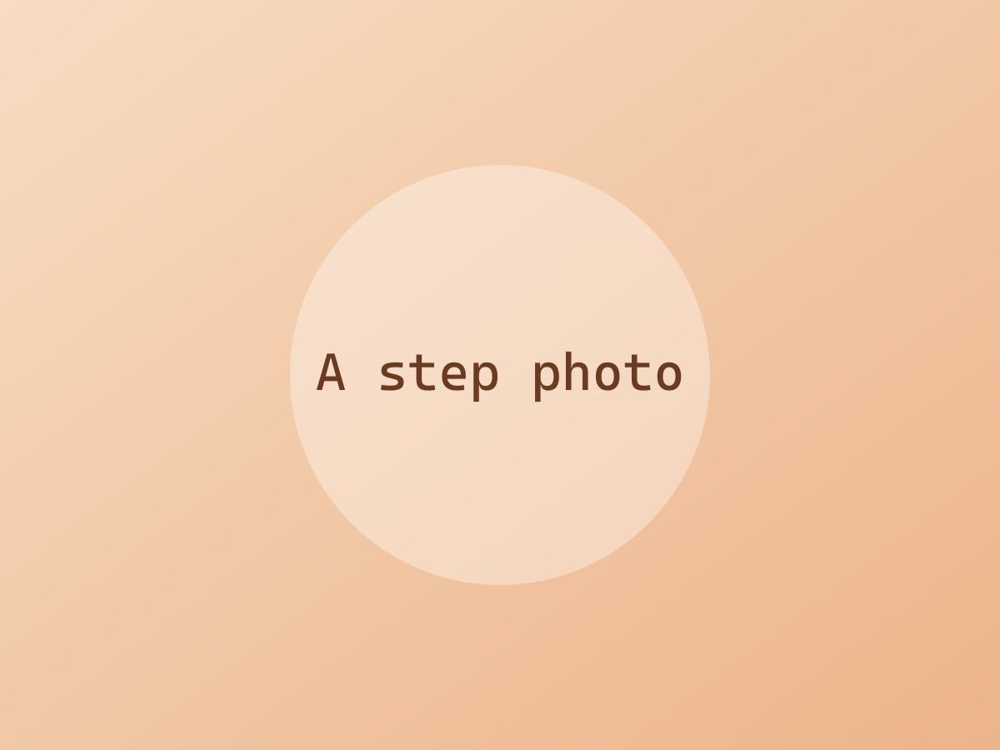

Write a sentence or two about the dish here: where it came from, what you changed, whether you'd make it again.

## Ingredients

- 200 g spaghetti
- 4 tbsp butter
- 4 cloves garlic, thinly sliced
- 1 handful parsley, chopped
- Parmesan, salt and black pepper

## Steps

1. Boil the pasta in well-salted water until just shy of done. Save a mug of the pasta water.

   

2. Melt the butter over medium-low heat and cook the garlic until fragrant, about 1 minute. Don't let it brown.
3. Add the pasta and a splash of pasta water. Toss until glossy.
4. Finish with parsley, parmesan and plenty of pepper.

## Notes

> Photos go in the same folder as `index.md`. Reference them with `./filename.jpg`; they are resized and converted automatically at build time.
